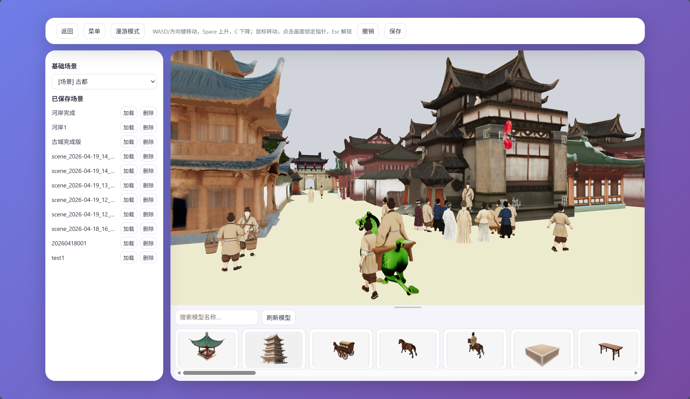
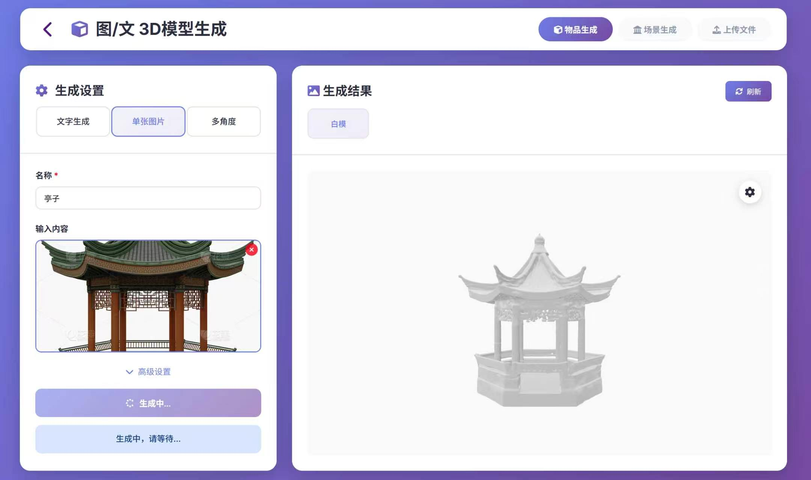
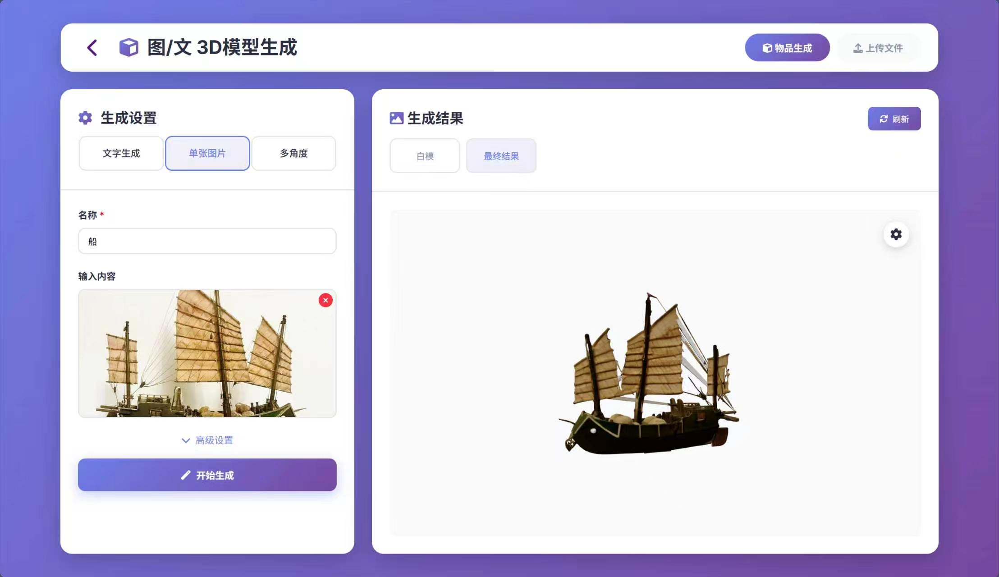
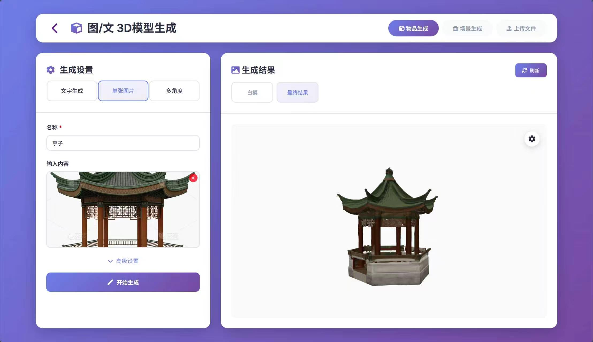
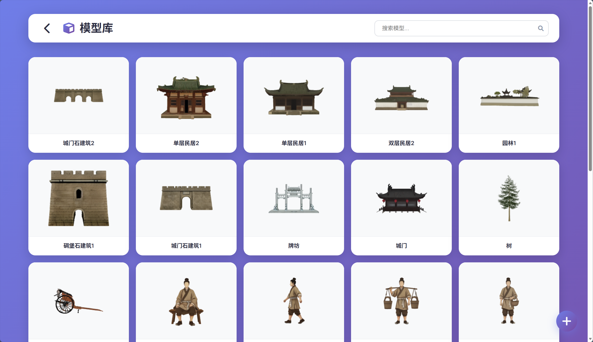
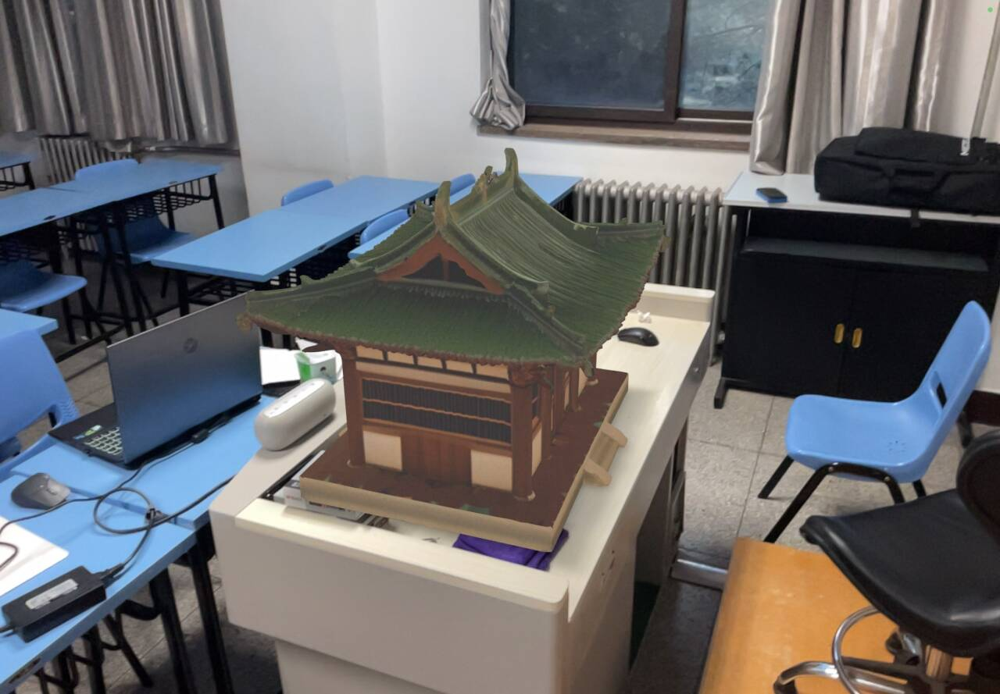

# 雕梁绘境｜Hunyuan3D World Builder

> 面向 3D资产 创作与 3D 场景体验的 Web 应用，串联 AI 模型生成、场景编辑和沉浸式展示。

## 项目简介

「雕梁绘境」将 Hunyuan3D 的生成能力与 Three.js 浏览器端 3D 渲染结合起来。用户可以从文字或图片创建 3D 资产，在模型库中管理模型，并把资产放进可编辑、可漫游的 3D 场景中；生成结果也可以通过 AR 页面在移动设备上查看。

项目提供一个 Flask Web 前端和一个独立的 FastAPI 模型推理服务。前端负责图片上传、模型预览、资产管理与场景交互；推理服务调用本地 Hunyuan3D 模型完成模型生成和贴图，并将结果保存为可供网页预览的 3D 文件。

## 核心功能

- **文字生成 3D**：输入物体描述，先生成参考图，再生成 3D 白模并生成贴图。参考图生成可使用火山引擎服务，也可回退到本地 HunyuanDiT 流程。
- **单图生成 3D**：上传一张图片，经过背景处理和 Hunyuan3D 单图模型生成网格；页面可分别预览白模与贴图模型。
- **多视角生成**：上传同一物体的多张角度图片，使用 Hunyuan3D 多视图模型生成模型，并基于参考图生成贴图。
- **多图场景生成**：在场景生成入口提交多张图片；当前后端复用 Hunyuan3D 多视角建模流程，生成可预览、可保存的场景模型资产。
- **模型库与文件上传**：浏览和预览模型，编辑名称与分类、删除资产；支持上传 GLB、GLTF、OBJ 文件。
- **场景搭建与漫游**：从模型库添加模型，在编辑模式下移动、旋转和缩放；支持阅览与第一人称漫游，并可保存、加载和删除场景。
- **AR 展示**：选择模型后在移动设备上查看，并从页面进入增强现实体验。当前页面说明要求 iOS 12+ 与 Safari。

## 技术栈

| 模块 | 技术 |
| --- | --- |
| Web 前端 | HTML、CSS、JavaScript、Jinja2 模板、Flask |
| 浏览器端 3D | Three.js r128、GLTFLoader、OBJLoader、OrbitControls、TransformControls |
| AR 模型展示 | `<model-viewer>` Web Component |
| Web 与推理 API | Flask、FastAPI、Uvicorn、REST API |
| 3D 生成与贴图 | Hunyuan3D-2 / `hy3dgen`、Hunyuan3D-Paint、PyTorch、CUDA |
| 参考图与图像处理 | HunyuanDiT、可选火山引擎图像服务、`hy3dgen` 背景去除 |
| 数据与文件 | SQLite、服务器本地模型文件目录 |

## 作品展示

### 场景编辑与漫游



### 3D 模型生成

| 生成白模 | 生成模型 | 生成贴图 |
| :---: | :---: | :---: |
|  |  |  |

### 模型库与 AR 展示

| 模型库 | AR 演示 |
| :---: | :---: |
|  |  |

---

## 安装

若要复现该项目，请确保使用linux系统，否则目录不可用
请确保项目目录空间大于50G，否则不足以安装

项目结构（简略版，server文件夹）

```tree
.
├── api
│   ├── api_server.py
│   ├── enhanced_api_server.py
│   └── volcano_engine_client.py
├── client
│   ├── app.py
│   ├── static
│   │   ├── icon_no_bg.ico
│   │   ├── icon_no_bg.png
│   │   └── img
│   │       ├── example0.png
│   │       ├── example1.png
│   │       └── example2.png
│   └── templates
│       ├── AR.html
│       ├── gen.html
│       ├── index.html
│       ├── reveal.html
│       └── space.html
├── database
│   ├── models.db
│   └── sqlite.py
├── README.md
├── static
│   ├── icon_no_bg.ico
│   ├── icon_no_bg.png
│   └── img
│       ├── example0.png
│       ├── example1.png
│       └── example2.png
├── temp
└── uploads

```

完整项目结构见`structure.md`

python环境依赖见`requirements.txt`
原pyhton版本为3.12.3
请安装好GPU驱动和支持的torch版本

请从modelscope/github/huggingface将3种turbo模型和delight模型克隆相应的模型文件到`Hunyuan3D-2/models/`
再从github克隆hy3dgen到同一文件夹
```shell
git clone https://github.com/Tencent-Hunyuan/Hunyuan3D-2.git
```
编译custom_rasterizer
``` shell
cd Hunyuan-3D-2/models/hy3dgen/texgen/custom_rasterizer
python3 setup.py install
```
编译mesh_processor
``` shell
cd Hunyuan-3D-2/models/hy3dgen/texgen/differentiable_renderer
python3 setup.py install
```

请安装去除背景模型


模型文件默认放在项目根目录的`Hunyuan3D-2/models/`，如需使用其他位置，可通过`HY3DGEN_MODELS`环境变量指定。

如需启用火山引擎图像服务，请将访问密钥配置在本地`.env`文件的`VOLCANO_ACCESS_KEY`和`VOLCANO_SECRET_KEY`中；不要将真实密钥提交到仓库。未配置时，文字生图会尝试使用本地模型。

## 启动

首先启动模型api服务

```shell
python3 api/api_server.py 
```

然后启动后端服务

```shell
python3 client/app.py
```

模型api服务运行在端口8081，后端运行在8082（记得放行）
